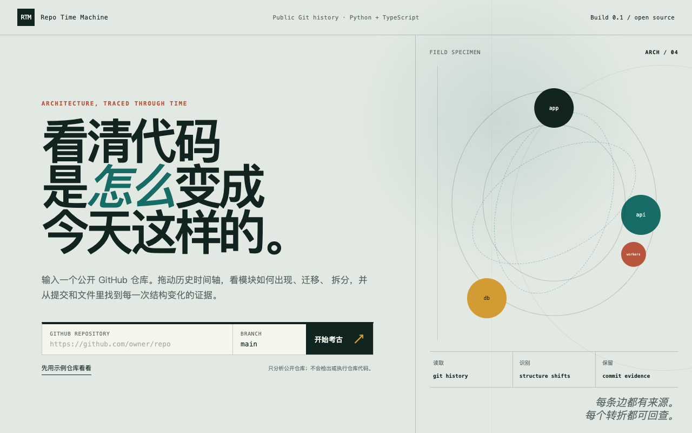

# Repo Time Machine

Repo Time Machine turns a public GitHub repository's history into an interactive
map of its architecture. Scrub through structural keyframes to see modules
appear, move, split, or disappear, then verify each change against commits and
file paths.



## What works

- Deterministic analysis of up to 2,000 first-parent, non-merge commits
- Python import extraction and TypeScript/JavaScript import extraction
- TypeScript path aliases from `tsconfig`
- Directory-level dependency aggregation with a 500-module budget
- Architecture keyframes, inferred split/merge candidates, and commit evidence
- CLI bundle generation
- Fastify API with task creation, status, cancellation, and compressed bundles
- Worker state machine with temporary-checkout cleanup and sanitized failures
- Next.js workspace with WebGL graph rendering, SVG fallback, timeline selection,
  keyboard-accessible module index, evidence panel, and responsive layout

## Quick start

Requirements: Node.js 22 and pnpm 11.

```bash
pnpm install
pnpm dev
```

Open `http://127.0.0.1:3000`. Choose “先用示例仓库看看” to explore without a
network request, or enter a public repository URL.

## CLI

Analyze any local Git checkout:

```bash
pnpm --filter @rtm/analyzer analyze /path/to/repository \
  --output analysis.json
```

Build a distributable CLI first if you want to run the package binary:

```bash
pnpm --filter @rtm/analyzer build
node packages/analyzer/bin/repo-time-machine.js analyze . --output analysis.json
```

## How analysis works

1. Git history is read without checking out or executing repository code.
2. Changed source blobs are parsed for local imports.
3. File imports are aggregated into weighted directory dependencies.
4. Commits are scored by node and edge changes; quiet edits are skipped.
5. The strongest structural slices are retained as immutable keyframes.
6. Every event carries the originating commit, author, date, and changed paths.

The output is validated against the shared Zod contract in `@rtm/contracts`.

## Repository layout

```text
apps/api       Fastify job and bundle API
apps/web       Next.js product shell
apps/worker    clone, analyze, publish, and cleanup
packages/ui    graph, timeline, evidence, and landing experience
packages/analyzer   Git traversal and language analysis
packages/contracts  shared runtime schemas
```

## Verification

```bash
pnpm typecheck
pnpm test
pnpm build
pnpm test:e2e
```

Tests use generated Git fixtures and do not require a remote repository.

## Limits

- Public repositories only
- First-parent history, capped at 2,000 commits
- Python and TypeScript/JavaScript-family files
- File-level imports, not symbol or runtime call graphs
- Version 0.1 runs a single embedded worker and local bundle volume
- PostgreSQL/pg-boss and shared object storage are the next production milestone

See [self-hosting](docs/self-hosting.md) for deployment details and security
boundaries.

## License

MIT
